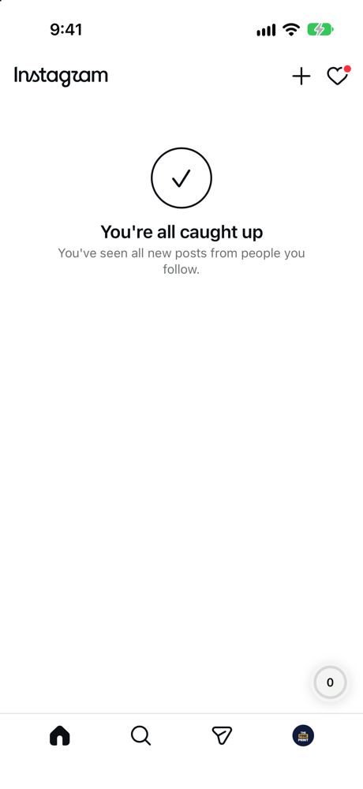
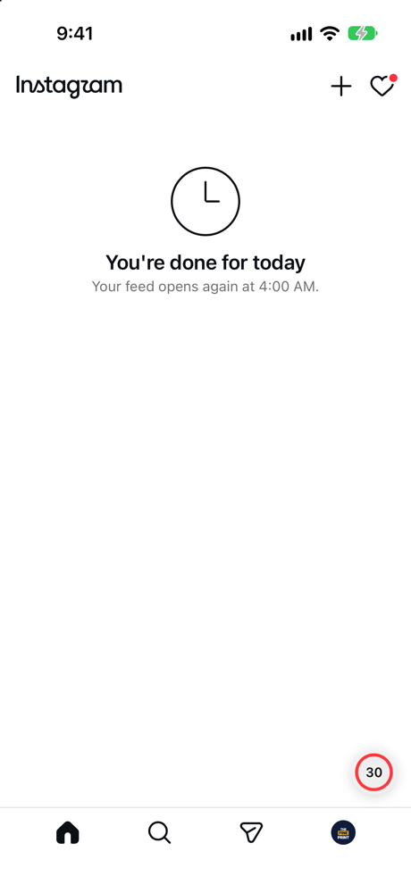
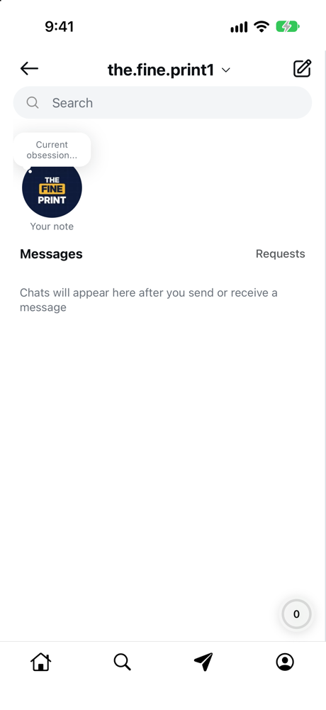
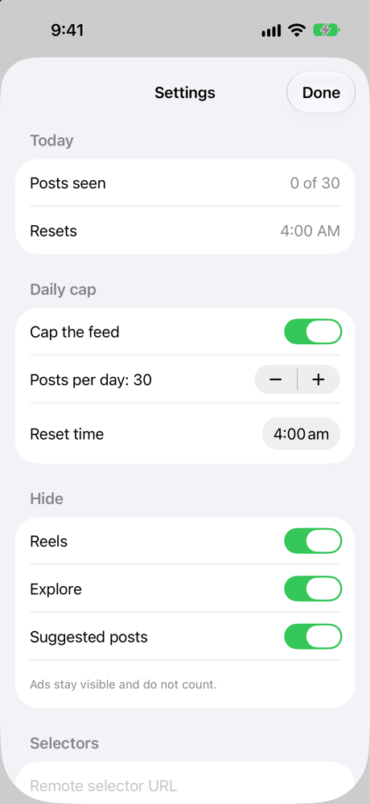
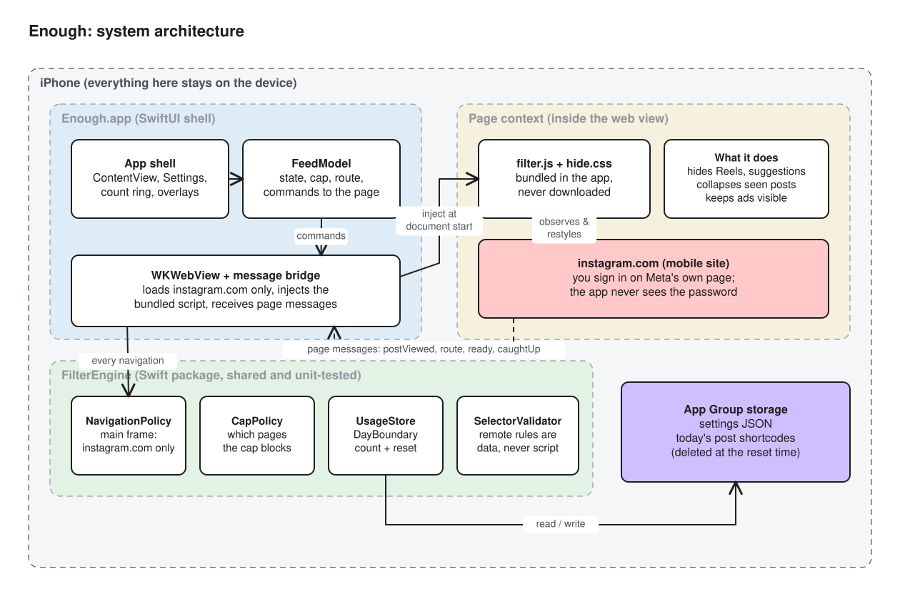

<div align="center">

# Enough

**Keep Instagram for your friends. Drop the endless feed.**

An iOS app that opens Instagram's website with a daily post limit. When you reach it, the feed stops. Messages, Search and your Profile keep working.

[](https://github.com/Zman2087/enough/actions/workflows/ci.yml)


</div>

<p align="center">
  
  &nbsp;
  
  &nbsp;
  
  &nbsp;
  
</p>

---

## Why

Instagram's feed is built so it never ends. Reels autoplay, Explore always has more, and "Suggested for you" refills the feed after you've seen everything from people you follow. Doomscrolling takes over because there is never a natural place to stop.

Screen Time limits and deleting the app both cost you the parts of Instagram that are worth keeping, like your friends' posts, your DMs and finding people you know.

**Enough adds a stopping point.** You choose how many posts a day is enough (30 by default). Once you've seen them, the feed closes until tomorrow. Everything else still works.

## What it does

| | |
| --- | --- |
| **Daily post cap** | Each post counts once, when at least half of it is on screen. Your own posts never count. When the count reaches the cap, the feed is replaced in place by *"You're done for today"*. The count stops at the cap, and post pages are covered, so there's no way around it by tapping into a post. |
| **Only people you follow** | Home shows posts from accounts you follow. Suggested posts and posts carrying their own *Follow* button are hidden. When you've seen them all, you get *"You're all caught up"*, not more content. |
| **No Reels, no Explore grid** | The Reels tab is removed. The Explore tab opens Search instead, so you can find accounts without a grid of recommended posts. |
| **Everything else still works** | Messages, Search, your Profile, notifications and posting all work normally, even after you reach the cap. |
| **Feels like the app** | The real site runs full screen, with its own header and tab bar. Videos play in place in the feed, and tabs switch in the page without reloading it. A small progress ring shows today's count, and tapping it opens Settings, where you can type a cap or use − and +. |
| **Resets on your schedule** | The day rolls over at a time you choose (4:00 AM by default), not at midnight. |
| **Private by design** | You log in on Instagram's own page, and the app never sees your password. The only data stored is today's count and the IDs of posts you've seen, kept on the device and deleted at reset. |
| **Ads stay ads** | Ads are left visible, as the platform requires, and they never count toward your cap. |

## How it works



Enough is a SwiftUI shell around one `WKWebView`. At document start it injects a bundled script, `filter.js`, and a stylesheet. The script finds posts and reports them to Swift once they're half on screen, and it hides Reels, Explore and suggestions. Swift stores the count and decides when the cap applies, then tells the page to show the notice. The script never comes from the network. Selector updates are validated JSON data only.

The full write-up is in **[docs/](docs/README.md)**:

- [Architecture](docs/architecture.md): the components and how they talk to each other
- [How counting works](docs/how-it-works.md): launch, counting, the cap, the reset
- [Key Design Decisions](docs/key-design-decisions.md): why it's built this way
- [Privacy & compliance](docs/privacy-and-compliance.md): the rules the app never breaks
- [Selectors](docs/selectors.md): how markup changes are handled without new code
- [Development](docs/development.md): building, testing, screenshots, diagrams

## Getting started

Requirements: macOS with **Xcode 16+**, iOS 16+ simulator or device. For the tests alone you need Swift 5.9+ and Node 20+, and they also run on Linux.

```sh
git clone https://github.com/Zman2087/enough.git
cd enough
make test                 # lint, Swift tests, JS tests
open Enough.xcodeproj     # choose the "Enough" scheme and press Run
```

Log in with your username and password on the page that appears. Facebook login is blocked on purpose, because it leaves instagram.com. Your session stays signed in between launches.

See [docs/development.md](docs/development.md) for signing, the `Enough Personal` scheme and the debug launch arguments.

## Project layout

```
App/                          SwiftUI shell: FeedModel, FeedWebView, Settings
Sources/FilterEngine/         platform-independent logic (Swift package + framework)
  Resources/filter.js         the page-side engine
  Resources/hide.css          hide rules and the in-feed notices
  Resources/selectors.json    the selector document
Tests/FilterEngineTests/      Swift tests (count, reset, routes, selectors)
js-tests/                     jsdom tests for filter.js
Extensions/                   Safari extension + Screen Time shield (stubs)
scripts/                      project generator, lint checks, diagram builder
docs/                         documentation, diagrams, screenshots
```

## Roadmap

- [x] Daily cap with in-feed notices, count ring and settings
- [x] Following-only home feed; no Reels or Explore grid
- [x] Ads excluded from the count
- [ ] Safari web extension running the same filter
- [ ] Screen Time shield for the native app once the Family Controls entitlement is approved
- [ ] TestFlight beta
- [ ] More platforms (profiles for TikTok and YouTube exist but aren't loaded yet)

## Contributing

Contributions are welcome. Read **[CONTRIBUTING.md](CONTRIBUTING.md)** first. Some rules are hard constraints, like no remote JavaScript and no hiding ads in the App Store build, and pull requests that break them can't be merged.

## Author

Enough was created by **[Zman2087](https://github.com/Zman2087)**. I wanted to keep up with friends on Instagram without losing an hour to the feed.

## Disclaimer

Enough is an independent project. It is not affiliated with, endorsed by or sponsored by Instagram or Meta Platforms, Inc. "Instagram" is a trademark of Meta Platforms, Inc. Enough displays the public instagram.com website. It doesn't use private APIs or collect, scrape or export any content.
