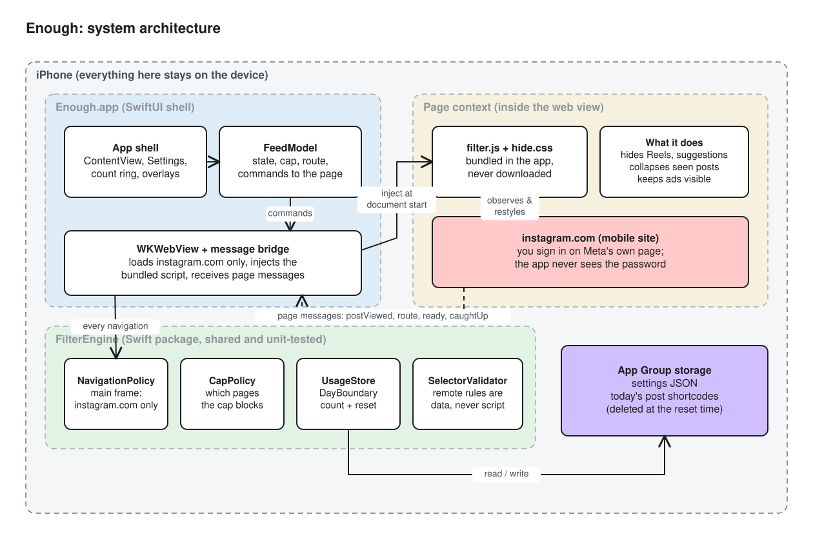
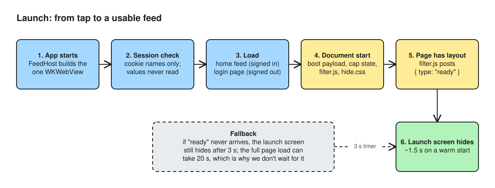
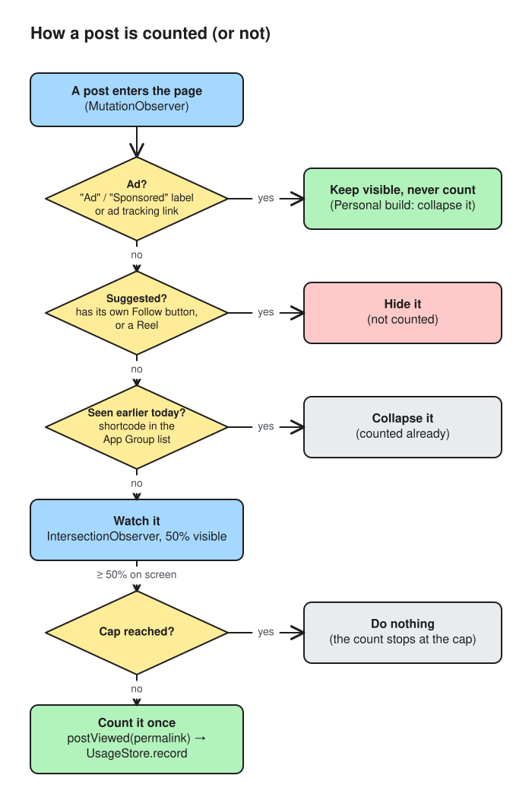
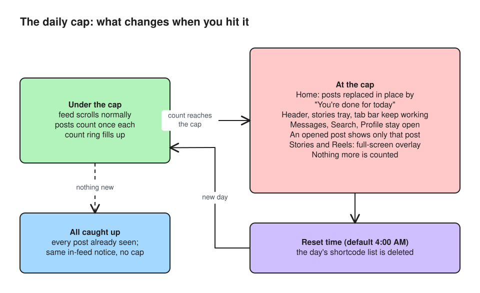
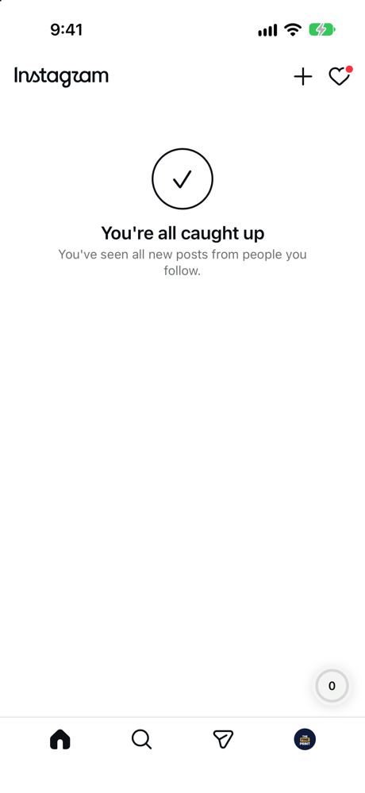
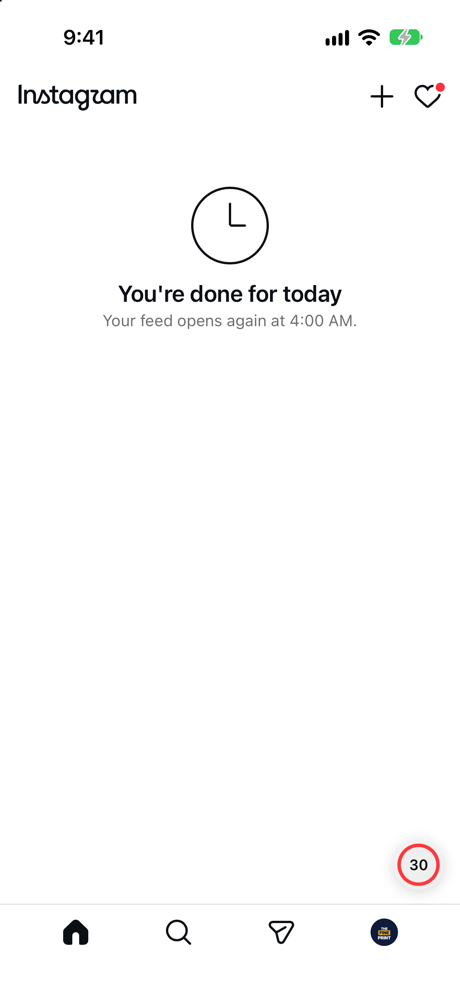
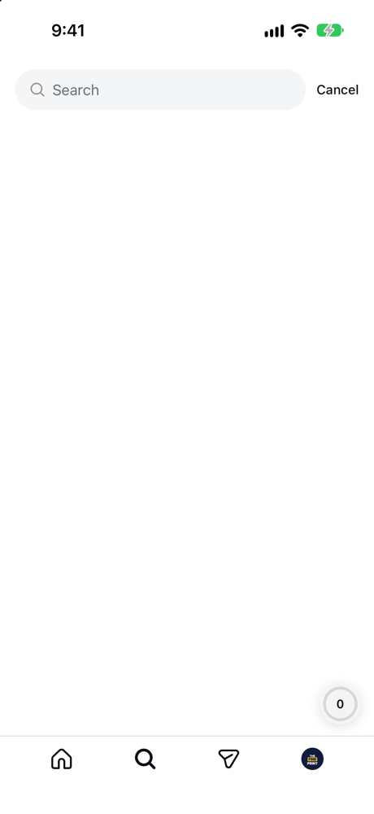
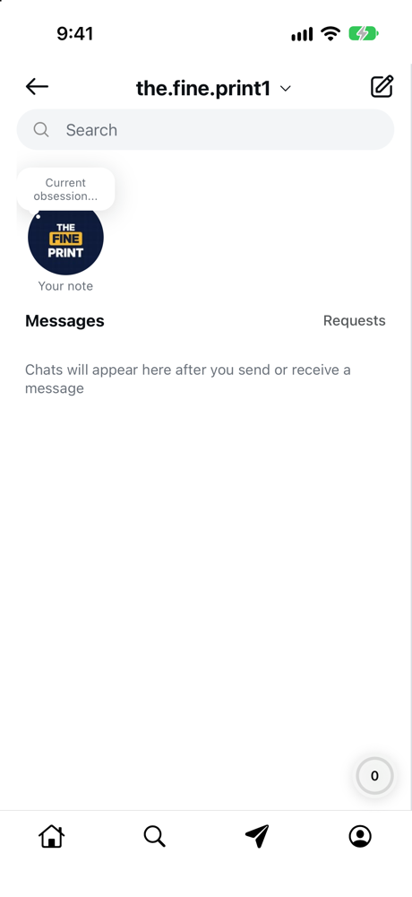
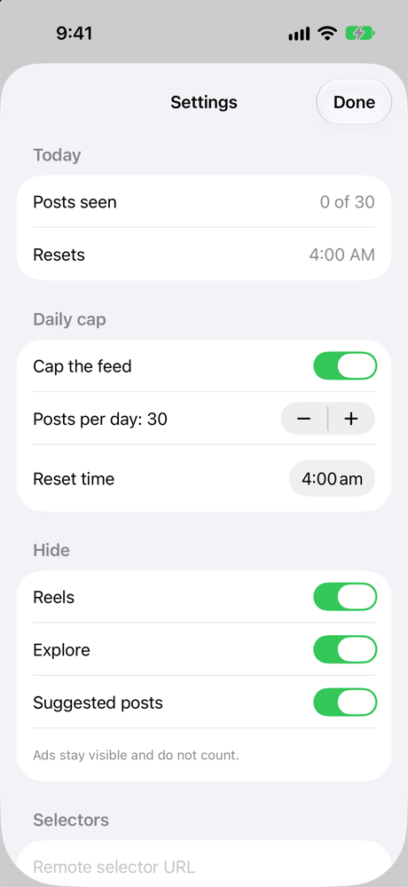

# Enough documentation

These docs explain how Enough works and why it's built the way it is. Start with the architecture, then read the parts you need.

| Document | What's in it |
| --- | --- |
| [Architecture](architecture.md) | The components, what each one owns and how they communicate |
| [How it works](how-it-works.md) | Step by step: launch, counting a post, reaching the cap, the daily reset |
| [Key Design Decisions](key-design-decisions.md) | The KDD log: each significant decision, the alternatives and the reasoning |
| [Privacy & compliance](privacy-and-compliance.md) | Hard rules: what the app stores, what it never does, App Store constraints |
| [Selectors](selectors.md) | The selector document, validation and how to respond when Instagram's markup changes |
| [Development](development.md) | Building, testing, debug launch arguments, screenshots, regenerating the project and diagrams |

## Diagrams

Every diagram is an [Excalidraw](https://excalidraw.com) file plus a rendered SVG. To edit one, open the `.excalidraw` file at excalidraw.com, or change `scripts/build_diagrams.py` and run it again, which rewrites both files.

| Diagram | Source |
| --- | --- |
|  | [architecture.excalidraw](diagrams/architecture.excalidraw) |
|  | [launch-sequence.excalidraw](diagrams/launch-sequence.excalidraw) |
|  | [post-counting.excalidraw](diagrams/post-counting.excalidraw) |
|  | [daily-cap.excalidraw](diagrams/daily-cap.excalidraw) |

## Screenshots

| Caught up | Daily cap | Search | Messages | Settings |
| --- | --- | --- | --- | --- |
|  |  |  |  |  |

The screenshots come from a test account on the iOS Simulator, using the debug launch arguments in [development.md](development.md#screenshots).
