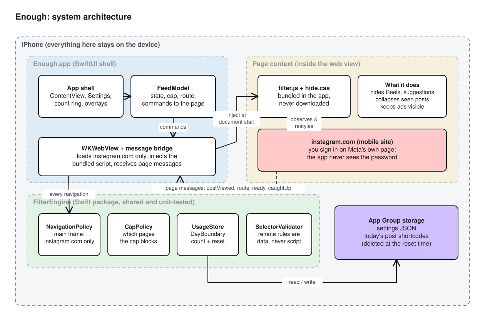

# Architecture



<sub>Source: [diagrams/architecture.excalidraw](diagrams/architecture.excalidraw)</sub>

Enough has three layers:

1. **The page layer.** `filter.js` and `hide.css` run inside instagram.com and see the DOM.
2. **The app layer.** SwiftUI plus `WKWebView` owns the window, the settings and the decisions.
3. **The engine.** `FilterEngine` is pure Swift that runs anywhere and holds every rule that can be unit-tested.

The page *observes*, Swift *decides* and the engine *remembers*.

## Components

### App shell (`App/`)

| File | Responsibility |
| --- | --- |
| `FeedWebView.swift` | `FeedHost` builds the one `WKWebView` at process start, so the first request is already in flight before SwiftUI draws. The file also installs the document-start user scripts, implements the navigation policy and bridges `enough` messages to the model. |
| `FeedModel.swift` | The observable state: today's snapshot, the current route and surface, loading and error state, and the scripts it builds (`bootScript`, `capScript`, `capUpdateScript`). It also handles commands sent to the web view (`openSearch`, `openMessages`, `openHome`, `openProfile`). |
| `ContentView.swift` | Composes the web view, the count ring, the Messages tab bar, the launch screen and the full-screen overlay for Reels, Explore and Stories at the cap. |
| `SettingsView.swift` | Cap toggle and size (1–500), reset time, hide toggles and the optional remote selector URL. Also holds the `DoneOverlay`. |

### FilterEngine (`Sources/FilterEngine/`)

This target is built two ways from one set of sources: as a **SwiftPM package**, which `swift test` uses on macOS or Linux, and as a **dynamic framework** that the app links. It must never import UIKit or WebKit.

| File | Responsibility |
| --- | --- |
| `Navigation.swift` | `PlatformCatalog` and `PlatformProfile` hold the host rules, install phrases, handoff schemes and default cap. `NavigationPolicy` limits the main frame to instagram.com. `CapPolicy` maps a path to a `Surface` and decides whether the cap blocks it. `StartDestination` chooses login or home. |
| `DayBoundary.swift` | Turns a date into a day key using the user's reset time. It is safe across daylight-saving changes. |
| `UsageStore.swift` | Records a permalink once per day and stops counting at the cap. Rolls over at the reset. The seen set holds at most 2,000 entries. |
| `Permalink.swift` | Normalises a post URL to `p/<shortcode>` or `reel/<shortcode>`. |
| `Storage.swift`, `EnoughSettings.swift` | Settings and usage stored as JSON in the App Group `group.app.enough.shared`. |
| `SelectorConfig.swift` | The selector document model and `SelectorConfigValidator`. |
| `EngineResources.swift` | Loads the bundled `filter.js`, `hide.css` and `selectors.json`. `WebBoot` builds `window.__ENOUGH_BOOT__`. |

### Page engine (`Sources/FilterEngine/Resources/`)

`filter.js` is written in UMD style. In the web view it reads `window.__ENOUGH_BOOT__` (selectors and toggles) and `window.__ENOUGH_CAP__` (cap state). Under Node it exports `createEngine`, `classifyPath` and `permalinkOf` so jsdom tests can drive it directly.

It uses:

- a **MutationObserver** to apply hide rules to content that loads later
- an **IntersectionObserver** (50% visible) to count posts
- a capture-phase **click handler** that sends Explore taps to Search

`hide.css` holds the static hide rules and the styles for the in-feed notices.

### Extensions (`Extensions/`)

- `Safari/` is a Safari web extension target with a manifest and a content script that does nothing yet.
- `Shield/` is a `ShieldConfigurationExtension` that returns a "You're done for today" shield. Its Family Controls entitlement stays commented out until Apple approves it.

Both are stubs. They exist so the project, signing and App Group are ready for later versions.

## The message bridge

The page sends messages to Swift through `window.webkit.messageHandlers.enough.postMessage({type, ...})`:

| `type` | Payload | Swift's response |
| --- | --- | --- |
| `postViewed` | `permalink` | `UsageStore.record`, then republish the snapshot |
| `route` | `path` | Update `routePath` and `surface`, and re-evaluate the overlay |
| `ready` | — | Drop the launch screen; the page can be used |
| `caughtUp` / `hasUnseen` | — | Track whether the follow feed is exhausted |
| `firstPost` | `ms` | Log the time to first post (debug) |

Swift talks back by evaluating small scripts (`capUpdateScript`, `reconfigureScript`). It also reinstalls the document-start scripts, so the *next* page load starts in the correct state and nothing flashes.

Messages from frames that aren't instagram.com are ignored.

## Data

```
App Group: group.app.enough.shared   (UserDefaults suite)
  enough.settings   {"capEnabled","dailyCap","resetHour","resetMinute","hideReels","hideExplore","hideSuggested","remoteConfigURL"}
  enough.usage      {"dayKey":"2026-11-04","seen":["p/AbC123", …]}
```

That is everything Enough stores. See [privacy-and-compliance.md](privacy-and-compliance.md).

## Build configurations

| Scheme | Configuration | Hides sponsored posts? | Use |
| --- | --- | --- | --- |
| Enough | Debug, Release | No | Development and App Store |
| Enough Personal | Personal | Yes (`PERSONAL_BUILD`) | Sideloaded personal builds only |

`scripts/check_release_ads.py` fails the build if `PERSONAL_BUILD` appears in Release or in the main scheme.
