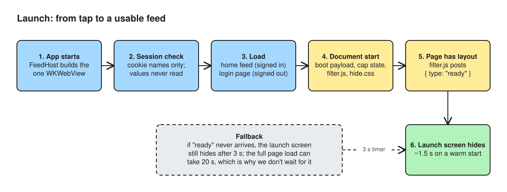
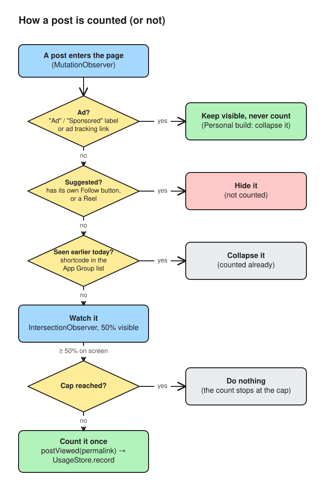
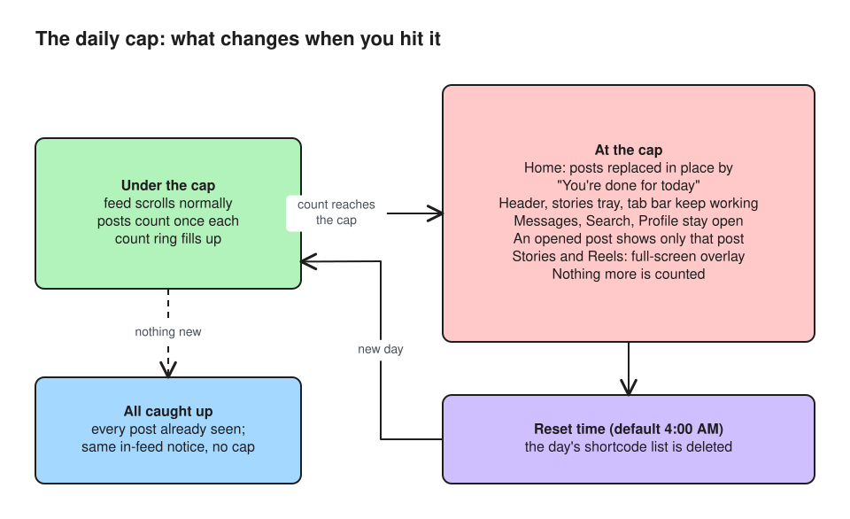

# How it works

This page follows one day of use from launch to reset.

## 1. Launch

Source: [diagrams/launch-sequence.excalidraw](diagrams/launch-sequence.excalidraw)

1. `FeedHost` is created with the app, before the first SwiftUI frame. It builds the `WKWebView` and installs three document-start scripts in this order:
   1. `__ENOUGH_BOOT__`: selectors and toggles
   2. `__ENOUGH_CAP__`: whether the cap is already reached, and the reset time
   3. `filter.js`
2. The cookie store is checked for a session cookie. Only names and domains are looked at, never values. Then the web view loads either `https://www.instagram.com/` or the login page.
3. The ink launch screen stays up until the page sends `ready`, which means the header or feed is on screen. A 3-second fallback removes it if the page is slow. The full page can take much longer on a cold network, and the app doesn't wait for it.

## 2. Filtering the page

As soon as `filter.js` runs, and again whenever the DOM changes:

- **Reels.** Links to `/reels/` are hidden, and the Reels tab's slot is removed so the tab bar has no gap. Reel posts (`/reel/…`) are hidden in the feed.
- **Explore.** The Explore tab is kept but retargeted to `/explore/search/`. A visit to bare `/explore/` is redirected there.
- **Suggestions.** Modules labelled with an exact phrase such as "Suggested for you" are hidden. On Home, any non-ad post that has its own **Follow** button is hidden, because it comes from an account you don't follow.
- **Install prompts.** "Open app", "Use the app" and App Store links are hidden. The navigation policy also cancels `instagram://` and App Store URLs.
- **Ads** are left alone. In the `Enough Personal` build only, they're collapsed.

## 3. Counting a post

Source: [diagrams/post-counting.excalidraw](diagrams/post-counting.excalidraw)

1. Each feed `article` is observed by an `IntersectionObserver` with a 50% threshold.
2. When it crosses the threshold, the script finds the post's permalink (`/p/<code>/` or `/reel/<code>/`).
3. **Ads are skipped.** A post is an ad if it carries a sponsored label ("Sponsored", "Paid partnership", "Ad") or a profile link containing `a_mpk=`.
4. If the cap is already reached, nothing is sent.
5. Otherwise the page posts `{type: "postViewed", permalink}`.
6. `UsageStore.record` normalises the permalink and ignores any it has seen today. It counts only while `count < cap` and saves to the App Group.
7. The model publishes the new snapshot, and the count ring updates.

Seen posts are marked `enough-seen` and collapse on later visits, so the feed starts with what's new. When nothing unseen is left, the page shows **"You're all caught up"** in the feed column, and the header, stories and tab bar keep working.

## 4. Reaching the cap

Source: [diagrams/daily-cap.excalidraw](diagrams/daily-cap.excalidraw)

When the count reaches the cap:

- Swift's `syncCap` evaluates `capUpdateScript` on the live page and reinstalls the document-start scripts with `reached: true`.
- **Home** replaces its posts with **"You're done for today"** and the reset time. The `html` element gets the class `enough-at-cap`, which hides posts and loading spinners. The site's header, stories row and tab bar stay usable.
- **Single post pages** are covered too (`capTrim`), so tapping into a post from a profile doesn't get around the cap.
- **Reels, Explore and Stories** are covered by a full-screen native overlay with buttons for Messages, Search and Profile.
- **Messages, Search, your Profile and settings** keep working.

`CapPolicy.shouldBlock` holds the rule: when the cap is on and `count >= cap`, the surfaces `feed`, `reels`, `explore` and `stories` are blocked.

## 5. The reset

`DayBoundary` turns "now" into a day key using the reset time, which is 4:00 AM by default. A post seen at 2 AM still belongs to yesterday. The first time `UsageStore` reads usage under a new key, it discards yesterday's seen list and starts from zero. No background task is needed, because rollover happens when the data is read.

The model refreshes every 30 seconds and when the app returns to the foreground, so the feed reopens at the reset time without a relaunch.
